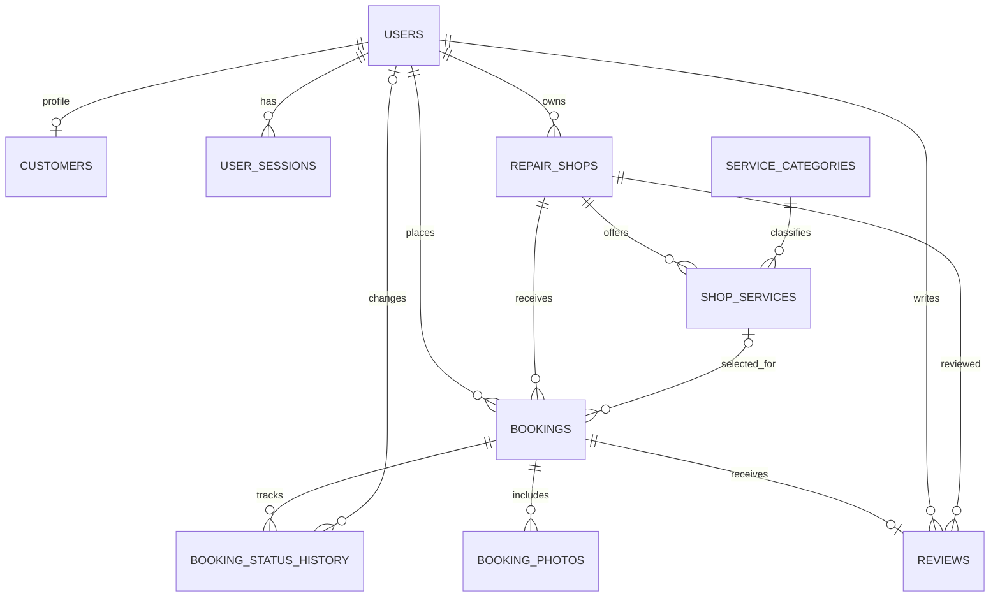

# HomeFix relational database schema

The application uses PostgreSQL. The executable core schema is in [`backend/db/migrations/001_homefix_core.sql`](../backend/db/migrations/001_homefix_core.sql), and the tables the current API uses are in [`002_application_tables.sql`](../backend/db/migrations/002_application_tables.sql). Apply both with `cd backend && npm run migrate` (the server also applies pending migrations on startup); see "Database migrations" in [`backend/README.md`](../backend/README.md). The core migration upgrades the earlier session table named `customers` back to `user_sessions`, preserving its rows, and creates customer profile records for existing customer accounts.

## Entity relationship diagram

## Entities and required fields

Generated entity identifiers use `BIGSERIAL`; the customer profile uses its user ID as a shared primary/foreign key, and sessions use a token hash as their primary key. All timestamps use `TIMESTAMPTZ` in UTC.

| Table | Purpose and required fields | Keys and constraints |
| --- | --- | --- |
| `users` | Customer, shop owner, or admin identity. `name`, `email`, `password_hash`, `role`, `created_at` required. | PK `id`; unique `email`; role check. Password is stored as a hash, never plaintext. |
| `customers` | Customer profile extension. `user_id`, `created_at`, `updated_at` required. | PK and FK `user_id` to users with cascade; one profile per customer account. |
| `user_sessions` | Authentication sessions. `token_hash`, `user_id`, `expires_at`, `created_at` required. | PK `token_hash`; FK to users with cascade; indexed expiry. |
| `repair_shops` | Repair business profile and service location. `owner_user_id`, `name`, `phone`, `address`, `district`, `city`, `service_mode`, `verified`, `status`, timestamps required. | PK `id`; owner FK; indexes for owner and active location search. |
| `service_categories` | Shared appliance/repair taxonomy. `name` required. | PK `id`; unique `name`. |
| `shop_services` | A named service and optional starting price offered by one shop. `shop_id`, `category_id`, `name`, `currency`, `active` required. | PK `id`; FKs to shop/category; unique `(shop_id, name)`; nonnegative price. |
| `bookings` | A customer's repair request and appointment. Customer/shop, service snapshot, appliance, issue, mode, address, contact name/phone, status, timestamps required. | PK `id`; unique public `booking_number`; FKs to customer/shop/service; nonnegative quote; status/mode checks. |
| `booking_status_history` | Auditable booking transitions. `booking_id`, `new_status`, `changed_at` required. | PK `id`; booking FK; optional actor FK; booking/time index. |
| `booking_photos` | Photo metadata for a reported fault. `booking_id`, `storage_url`, `uploaded_at` required. | PK `id`; booking FK; file bytes remain in object/file storage, URL is stored here. |
| `reviews` | Customer rating after a booking. `booking_id`, `customer_user_id`, `shop_id`, `rating`, `created_at` required. | PK `id`; one review per booking; rating 1–5; FKs to booking/customer/shop. |

## Data type choices

- `BIGSERIAL` identifiers give related tables a consistent numeric key with room to grow.
- `VARCHAR` is used for bounded names, emails, phone numbers, state codes, and filenames. Addresses and explanatory text use `TEXT`.
- `NUMERIC(10,2)` stores prices without floating point rounding; `CHAR(3)` stores ISO-style currency codes.
- `BOOLEAN` stores flags, `SMALLINT` stores review stars, and `TIMESTAMPTZ` stores instants consistently across time zones.
- Booking status, service mode, role, rating, price, and currency constraints reject invalid values at the database boundary.

## Workflow and relationship notes

1. A person registers in `users`; customer accounts also receive a `customers` profile row and a login record in `user_sessions`. A shop owner is still a user; one user may own multiple shops. The account `role` is authorization metadata and should be changed to `shop_owner` when shop registration completes.
2. A shop lists categories and individual services through `shop_services`. Many shops can offer the same category; a shop can offer several services.
3. A customer submits a booking for a shop and optionally selects a listed service. `service_name_snapshot` preserves the requested service label even if that listing is later edited or removed. Booking contact details are snapshots so updates to the customer's profile do not rewrite an existing request.
4. The shop confirms, declines, or completes work by changing `bookings.status`; each transition should also insert `booking_status_history` in the same transaction.
5. Photos attach to a booking. A review is tied to one booking, so the database enforces at most one review per job.

## Shop profile API

The shop search schema in `backend/src/schema/shops.js` stores the profile fields used by the current directory API: `owner_user_id`, `name`, `description`, `address`, `location`, `phone`, `operating_hours`, and `image_url`. `GET /api/owner/shop-profile` returns the authenticated owner's linked shop; `PUT /api/owner/shop-profile` updates its name, description, address, phone, operating hours, and optional image URL. Both require a valid session, and writes are scoped to `owner_user_id`. Administrators can update a selected shop through `PUT /api/admin/shops/:shopId/profile`. Images are stored as URLs; uploaded image files are not handled by this endpoint.

## Delete behavior

Sessions, booking history, and photos cascade with their parent. A referenced shop or user cannot be deleted while bookings/reviews depend on it (`RESTRICT`), preserving business records. Removing a service listing sets a booking's optional service FK to null while its snapshot remains. Prefer soft status changes for users and shops when records have operational history.

## Existing auth integration

Migration `001` creates `users`, `customers`, and `user_sessions`; migration `002` adds the case-insensitive unique email index and allows the `owner` role the API assigns to shop owners. Customer registrations create the user and profile in one transaction. The single core migration restores the session table's proper name and creates the customer profile table.

## Runtime booking status API

The current repair-request UI uses `repair_requests` and `repair_request_status_history`, created by migration `002_application_tables.sql`. These runtime tables are separate from the core `bookings` schema above.

- `GET /api/repair-requests` returns database records belonging to the signed-in customer, or records assigned to the signed-in owner's approved shop. Supports `status`, `emergency`, `page`, and `limit` filters.
- `PATCH /api/repair-requests/:requestId/status` accepts `{ "status": "Accepted" }`, `In Progress`, or `Completed`. To reject, send `{ "status": "Rejected", "rejectionReason": "No technician available" }`; a trimmed reason of 1-500 characters is required.
- Owner transitions are `Pending -> Accepted -> In Progress -> Completed`, or `Pending -> Rejected`. Completed, rejected, and cancelled requests cannot be reopened. Other transitions return HTTP 409. Unauthorized owners receive HTTP 404; customers cannot perform owner transitions.
- Updates lock the request row, validate shop ownership and the current status, and commit the status and timestamped history together. A history-write failure rolls back the status update.
- Customers may cancel their own Pending or Accepted requests using the same endpoint with `status: Cancelled`, `cancellationReason`, and optional `cancellationDetails`. This preserves the existing cancellation UI when moving bookings to database storage.
- Customer lists and details refresh on page focus and every 15 seconds. Owner actions await the API response before reporting success. Browser-only demo bookings are not treated as database records.

Verify with `node --test backend/src/routes/bookingStatus.database.test.js backend/src/routes/repairRequests.test.js` and `node --test frontend/src/data/ownerRequests.test.js frontend/src/data/repairRequestApi.test.js`. The database integration test executes PostgreSQL queries using PGlite without modifying the configured application database.

## Emergency repair requests

Emergency priority is stored as `repair_requests.priority = 'emergency'`; optional urgency notes are stored in `urgency_information`. Notes are trimmed, limited to 1000 characters, and accepted only for emergency requests. Emergency requests begin as Pending and do not imply acceptance, an appointment, or immediate service.

Approved shops must explicitly offer emergency services using `shop_registrations.supports_emergency`. The column defaults to false, including for existing shops. Owners can opt in during registration or change the setting on `/owner/emergency-requests`. Authenticated `GET` and `PATCH /api/shops/owner/emergency-service` read/update only the current owner's shop; PATCH requires a boolean `supportsEmergency`. Disabling the setting prevents new emergency submissions and preserves existing requests.

Both customer forms filter shops by category and `supportsEmergency`. The submission API independently checks approval, category, and emergency support in the transaction before creating a request. Customers and assigned owners receive the emergency flag and urgency notes through the authorized request endpoints. Customer details and owner queues display the flag and notes. Customer-facing wording makes clear that immediate service and availability are not guaranteed.

Run `npm run migrate` in `backend/` (or restart the backend) after updating to apply the schema additions. Test emergency eligibility, persistence, validation, ownership, and opt-out behavior with `node --test backend/src/routes/emergencyRequests.database.test.js`.
